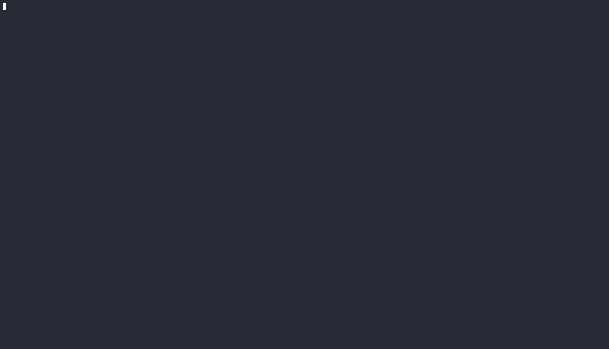

# Concept: локальний Kubernetes для PoC «AsciiArtify»

## 1. Вступ

AsciiArtify потрібне локальне середовище Kubernetes для розробки та PoC.
Розглянуто три інструменти, які запускають кластер у контейнерах на одній машині:

- **minikube** — офіційний інструмент спільноти Kubernetes для локального кластера. Підтримує різні драйвери (Docker, Podman, VirtualBox, Hyper-V, KVM тощо) та має систему аддонів.
- **kind** (Kubernetes IN Docker) — запускає вузли Kubernetes як Docker-контейнери. Створений для тестування самого Kubernetes і для CI.
- **k3d** — легка утиліта командного рядка для запуску k3s (мінімального дистрибутива Kubernetes від Rancher) всередині контейнерів Docker.

Усі інструменти перевірено практично в однаковому середовищі: Windows + WSL2, Docker 29.9, kubectl 1.36.

## 2. Характеристики, переваги та недоліки

| Критерій | minikube | kind | k3d |
|---|---|---|---|
| ОС | Linux, macOS, Windows | Linux, macOS, Windows | Linux, macOS, Windows |
| Архітектури | amd64, arm64 | amd64, arm64 | amd64, arm64 |
| Середовище запуску | Docker, Podman, VM (VirtualBox, Hyper-V, KVM…) | Docker, Podman (експериментально) | Docker, Podman (через сокет, з обмеженнями) |
| Дистрибутив K8s | upstream (kubeadm) | upstream (kubeadm) | k3s (один бінарник, SQLite замість etcd) |
| Версія K8s (тест) | v1.37.0 | v1.37.0 | v1.35.5+k3s1 |
| Автоматизація | CLI-прапорці, профілі | YAML-конфіг кластера | YAML-конфіг кластера, CLI |
| Моніторинг | addon `metrics-server` | немає, ставиться вручну | metrics-server вбудований |
| Dashboard / UI | addon `dashboard` | немає | немає (ставиться окремо) |
| Ingress / LoadBalancer | addons `ingress`, `minikube tunnel` | немає | Traefik + ServiceLB вбудовані |
| Локальні образи | `minikube image load` | `kind load docker-image` | `k3d image import`, `k3d registry create` |
| Кілька вузлів | ⚠️ `--nodes N`, але вузли створюються послідовно та повільно | ✅ Через YAML-конфіг, швидко | ✅ `--servers N --agents N`, вузли створюються паралельно |
| Легкість використання | ✅ Найпростіший для новачків: аддони вмикаються однією командою, зрозумілі повідомлення | ⚠️ Простий CLI, але ingress, LB та моніторинг доводиться ставити вручну | ✅ Простий CLI, ingress, LB та моніторинг працюють «з коробки» |
| Швидкість розгортання | ❌ Найповільніший: 44 с для 1 вузла, 1:27 для 2 вузлів | ✅ Швидкий: 21 с для 1 вузла, 52 с для 2 вузлів до Ready | ✅ Найшвидший: 21 с для 1 вузла, 24 с для 2 вузлів |
| Споживання ресурсів | ❌ Найбільші образи (532 MB), CPU у простої 483m | ⚠️ Образ 388 MB, RAM на рівні minikube | ✅ Найменші образи (125 MB), найнижче CPU (141m); ❌ більше RAM через вбудовані компоненти |
| Стабільність роботи | ✅ Зрілий проєкт, upstream Kubernetes | ✅ Використовується для тестування самого Kubernetes | ✅ Стабільний для розробки, k3s використовується в edge та продакшні |
| Відповідність upstream Kubernetes | ✅ Повний upstream (kubeadm), актуальна версія | ✅ Повний upstream, версія задається образом вузла | ❌ k3s: інші компоненти за замовчуванням (SQLite, Traefik), версія відстає |
| Документація та спільнота | ✅ Найбільша спільнота, найповніша документація | ✅ Офіційний проєкт Kubernetes SIG, хороша документація | ⚠️ Менша спільнота, документація коротша |
| Складність налаштування | ✅ Мінімальна завдяки аддонам | ❌ Для доступу ззовні потрібні extraPortMappings, ingress-nginx, MetalLB; metrics-server — з патчем TLS | ✅ Мінімальна: проброс портів через `-p "8080:80@loadbalancer"` |
| Особливості | ✅ VM-драйвери, якщо Docker недоступний; ❌ незручно тримати кілька кластерів одночасно | ✅ Декларативний конфіг, ідеальний для CI; ❌ без `--wait` повертає керування до готовності вузлів | ✅ Вбудований реєстр образів і `k3d image import` |

### Результати практичних тестів (WSL2, Docker 29.9)

| Метрика | minikube | kind | k3d |
|---|---|---|---|
| Розмір образів (завантаження) | 532 MB | 388 MB | **125 MB** |
| Розмір на диску | 1.9 GB | 1.34 GB | **478 MB** |
| Холодний старт (з завантаженням) | 3:39 | 1:36 | **0:39** |
| Старт, 1 вузол | 44 с | 21 с* | **21 с** |
| Старт, 2 вузли (до Ready) | 1:27 | 52 с | **24 с** |
| RAM control-plane | **~516 MiB** | ~545 MiB | ~720 MiB** |
| CPU у простої | 483m | ~15–20 % | **141m** |

\* без очікування стану Ready  
\** разом із вбудованими Traefik, metrics-server та ServiceLB

## 3. Ризики ліцензування Docker та Podman

- **Docker Desktop** безкоштовний лише для компаній до 250 співробітників і з доходом до $10 млн на рік. Далі потрібна платна підписка. Зараз AsciiArtify під умови підпадає, але при зростанні це стане ризиком.
- **Docker Engine** (Linux) має ліцензію Apache 2.0 і безкоштовний завжди, зокрема для комерційного використання.
- **Podman** — open source (Apache 2.0) альтернатива від Red Hat: без демона, з rootless-режимом і CLI, сумісним із Docker. Є безкоштовний Podman Desktop. Підтримка в minikube, kind та k3d поки експериментальна.

**Рекомендація (для локальних робочих станцій розробників):**
- Linux — Docker Engine (Apache 2.0, безкоштовний);
- Windows — Docker Engine у WSL2 або Rancher Desktop замість Docker Desktop;
- macOS — Rancher Desktop, Colima або Podman Desktop.

Podman — повноцінна open source альтернатива, але підтримка в kind/k3d/minikube поки експериментальна,
тому для команди без досвіду DevOps він розглядається як резервний варіант.

Продакшн-середовище не залежить від цього вибору: там використовується керований Kubernetes
(GKE/EKS/AKS) або k3s на серверах з containerd, де ліцензія Docker Desktop не застосовується.

## 4. Демонстрація

Розгортання «Hello World» на k3d: кластер з 2 вузлів, 2 репліки, доступ через вбудований Traefik ingress, балансування між подами, вбудований моніторинг.



Запис терміналу: [demo.cast](demo.cast) — відтворити локально: `asciinema play doc/demo.cast`

Команди демо:
```bash
# 1. кластер з двох вузлів, порт 8080 прокинуто на вбудований LoadBalancer
k3d cluster create demo --agents 1 -p "8080:80@loadbalancer"
# 2. застосунок Hello World на дві репліки
kubectl create deployment hello --image=us-docker.pkg.dev/google-samples/containers/gke/hello-app:1.0 --replicas=2
kubectl expose deployment hello --port=80 --target-port=8080
kubectl create ingress hello --rule="/*=hello:80"
# 3. перевірка через Traefik ingress: Hostname змінюється — працює балансування
curl localhost:8080
# 4. вбудований моніторинг
kubectl top nodes
# 5. видалення кластера
k3d cluster delete demo
```

## 5. Висновки та рекомендації

### Порівняльна оцінка для PoC AsciiArtify

Оцінка за 5-бальною шкалою, виходячи з потреб стартапу: швидкий старт, мінімум DevOps-налаштувань,
можливість перевірити масштабування та доступ до застосунку ззовні.

| Критерій | minikube | kind | k3d |
|---|---|---|---|
| Швидкість створення кластера | 2 | 4 | **5** |
| Легкість для команди без DevOps-досвіду | **5** | 3 | 4 |
| Кілька вузлів (перевірка масштабування) | 3 | 4 | **5** |
| Ingress / LoadBalancer «з коробки» | 3 | 1 | **5** |
| Моніторинг «з коробки» | 4 | 1 | **5** |
| Відповідність upstream Kubernetes | **5** | **5** | 3 |
| Споживання ресурсів (диск, RAM, CPU) | 2 | **4** | **4** |
| Документація та спільнота | **5** | 4 | 3 |
| Робота без Docker Desktop (Podman, VM) | **4** | 3 | 3 |
| **Разом** | **33** | **29** | **37** |

### Рекомендації щодо кожного інструменту

**k3d — основний інструмент для PoC** ✅
- Кластер з кількох вузлів піднімається за ~20–25 с, тож його легко перестворювати під кожен експеримент.
- Traefik ingress, ServiceLB і metrics-server працюють одразу: застосунок доступний через `localhost` без додаткових налаштувань, а `kubectl top` та HPA можна використовувати для перевірки масштабування ML-сервісу.
- `k3d image import` та вбудований реєстр спрощують цикл «зібрав образ → задеплоїв».
- Ризик: k3s відрізняється від upstream Kubernetes (версія, компоненти за замовчуванням). Його закриває kind у CI.

**kind — допоміжний інструмент для CI**
- Upstream Kubernetes з явно заданою версією, декларативний YAML-конфіг, мінімальна залежність від хоста.
- Рекомендовано для GitHub Actions: інтеграційні тести маніфестів і Helm-чартів на тій версії Kubernetes, яка буде в продакшні.
- Для щоденної розробки менш зручний: немає ingress, LB та моніторингу, потрібні ручні налаштування.

**minikube — для навчання, не для PoC**
- Найкращий варіант, щоб команда вивчила Kubernetes: dashboard і аддони вмикаються однією командою, документація найповніша.
- Для PoC не рекомендовано: найповільніший старт (44 с для одного вузла, 1:27 для двох), найбільші образи (532 MB), повільне створення кількох вузлів.
- Корисний як запасний варіант, якщо Docker недоступний (VM-драйвери) або потрібен драйвер Podman.

### Підсумок

Для локального Kubernetes-кластера в PoC AsciiArtify рекомендовано **k3d**. Він найшвидший і найлегший
за розміром образів, підтримує кілька вузлів і має ingress, LoadBalancer та моніторинг «з коробки».
Розробники без DevOps-досвіду отримують робоче середовище, близьке до реального, однією командою.

Щоб компенсувати відмінності k3s від upstream Kubernetes, у CI варто використовувати **kind** з тією ж
версією Kubernetes, що й у майбутньому продакшн-кластері.

Як контейнерне середовище, щоб уникнути ліцензійних ризиків Docker Desktop: Docker Engine
(Linux/WSL2) або Rancher Desktop, а Podman — як резервна альтернатива.

### Наступні кроки
1. Додати в репозиторій конфіг кластера `k3d-config.yaml`, щоб усі розробники мали однакове середовище.
2. Налаштувати GitHub Actions з kind для перевірки маніфестів.
3. Після PoC обрати продакшн-платформу (GKE/EKS/AKS або k3s на серверах).
